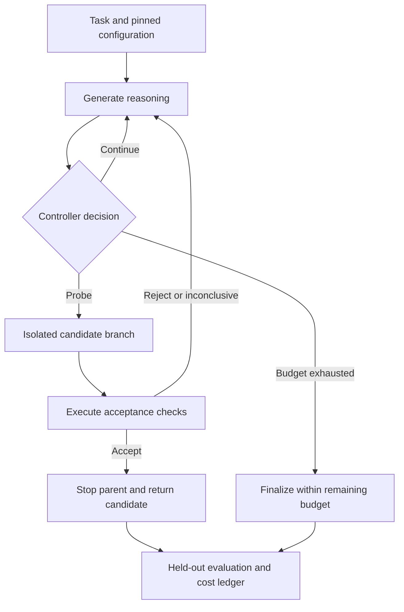

# ProofStop

**Cost-aware early exit for verifiable reasoning.**

ProofStop is an open-source research project for an inference controller that
decides when to continue reasoning, probe a candidate answer, or stop generation. Its objective
is to reduce compute cost per successful task, including the cost of verification.

**Status:** baseline prototype. A Rust CLI validates pinned tasks, runs Python
candidates in isolated Docker containers, and records a single model request and
its verification outcomes. An experimental Qwen3/vLLM adapter now runs exact-token
segments and separate answer probes, stopping future generation on acceptance.
Adaptive scheduling and measured GPU-efficiency benefits remain unestablished.
See the [online stopping loop](docs/online-probes.md) for the four controls.

The [first live A40 experiment](experiments/2026-10-12-qwen3-8b/README.md)
recorded two truncated thinking attempts and a non-thinking control that passed
all 12 fixture checks in 126 output tokens. This is development evidence, with
no demonstrated early-exit or GPU-efficiency benefit.

## Get started

Prerequisites: Rust 1.96.0 and a running Docker daemon. The toolchain,
dependencies, task files, and verifier image are pinned. Commands below run from
the repository root.

```bash
cargo build --locked
docker pull python@sha256:a6e34c598f2467ed0e9a8d349809fcd8b5c603269512df273a0bb1784edc11b1
cargo run --locked -- inspect --show-prompt
cargo run --locked -- verify --candidate tests/fixtures/reference.py
```

To reproduce the unfixed bug, verify `tasks/merge-ranges/repo/ranges.py` instead.
That command exits unsuccessfully, as expected. The reference fix is a harness
control; it is never supplied to the model.

Against a separately provisioned vLLM-compatible server:

```bash
cargo run --locked -- baseline \
  --endpoint http://127.0.0.1:8000/v1 \
  --model Qwen/Qwen3-8B \
  --output runs/first-baseline
```

This makes one non-streaming chat-completion request. It saves the exact request
and response bodies, candidate source, configuration, task manifest, event
ledger, and final summary. The output directory must not already exist.
It does not launch a model server, rent hardware, or perform early stopping.
The initial adapter supports an endpoint without authentication; do not expose
an unauthenticated model server publicly.

Run the local checks:

```bash
cargo test --locked --all-targets
cargo test --locked --tests -- --ignored --test-threads=1
cargo fmt --check
cargo clippy --locked --all-targets -- -D warnings
```

The second test command requires Docker and the pinned image. It exercises real
candidate execution, timeout cleanup, containment, and a mock-inference-to-verifier
flow. Mock inference validates the harness, not model capability or savings.

## Research question

Can an online controller reduce the total compute required to solve a task by
testing candidate answers before a reasoning model finishes its natural
continuation?

An earlier answer can be cheaper, but extracting and checking it also costs
compute. Frequent probes can erase the savings. An incomplete verifier can accept
an incorrect answer. Cancellation may arrive after additional tokens have been
generated. ProofStop will measure these costs and failure modes explicitly.

The initial hypothesis is that a controller which adapts its probing schedule can
outperform both a fixed reasoning budget and periodic probing on tasks with
executable acceptance checks. This is a hypothesis to test, not an established
advantage or a claim of a new early-stopping algorithm.

## Initial scope

The first workload is repairing a buggy Python function in a miniature pinned
repository, given its source, contract, and visible acceptance examples. A
separate evaluation suite tests the returned replacement file.

The model sees acceptance examples. Evaluation inputs and reference outputs are
excluded from its prompt. The controller must receive acceptance outcomes, not
evaluation results. Passing acceptance checks means only
that those checks passed; it does not establish general program correctness.

The first experiment uses one open-weight reasoning model, one GPU, sequential
requests, and bounded context and output lengths. The provisional model is
[Qwen3-8B](https://huggingface.co/Qwen/Qwen3-8B), whose official model card documents
thinking and non-thinking modes. Its exact revision, tokenizer, chat template,
precision, and inference dependencies must be pinned before execution.

Initially out of scope: model training, open-ended answer grading, distributed
serving, multi-model routing, and production deployment.

### First task: nested-range merge

[`tasks/merge-ranges`](tasks/merge-ranges/spec.md) is a synthetic development
fixture, identified as `merge-ranges / synthetic-v1`. Its manifest pins the
source, specification, and both test suites by SHA-256. Loading a modified fixture
fails rather than silently changing the workload.

The bug is concrete: merging `[(1, 10), (2, 3)]` shrinks the result to `[(1, 3)]`.
The correct result is `[(1, 10)]`. The function must also handle adjacent ranges,
invalid ranges, and empty input without mutating its arguments.

The fixture has four acceptance cases and eight evaluation cases. Evaluation
cases are published for reproducibility but withheld from model requests; this
development fixture is not a held-out research benchmark. Larger experiments
require an independently frozen evaluation partition.

## Locked implementation architecture

| Layer | Implementation |
| --- | --- |
| Controller and CLI | Rust, with Tokio for asynchronous I/O and process lifecycle. |
| Inference transport | Rust HTTP client to a separately running vLLM-compatible server. |
| Candidate execution | Python inside a digest-pinned, disposable Docker container. |
| Verification scoring | Rust compares returned values with expected results outside the container. |
| Run artifacts | JSON request/response bodies and summaries, plus a JSONL event ledger. |

Each suite runs in a fresh container with no network, a read-only root and source
mount, a non-root user, dropped capabilities, and bounded memory, CPU, processes,
output, and wall time. Candidate containers receive input values but no expected
answers, task manifest, or test-suite files. Docker must be available; there is
no host-execution fallback.

The current baseline freezes the candidate before acceptance and evaluation.
It records reported token counts, including truncated completions, and leaves
unobserved GPU measurements and model/backend revisions unknown. Client wall
time is not reported as allocated GPU time.

A candidate that fails to import, raises `SystemExit`, or returns a value that
cannot be serialized is scored as failed. Only harness faults such as timeouts,
Docker errors, and malformed worker output are inconclusive.

The baseline transport has a 1 MiB response-body limit. Transport failures may
have no captured response; their failed attempt remains in the ledger. The Python
worker is a finite functional checker, not an adversarially sound proof system.
Process interruption or Docker daemon failure can prevent cleanup; those failures
must be addressed before production use. This prototype is for dedicated,
synthetic research workloads.

## Proposed architecture



| Component | Responsibility |
| --- | --- |
| Inference adapter | Track token IDs and checkpoints; extract a candidate without corrupting the parent; stop generation and account for any work after the stop decision. |
| Probe controller | Select checkpoints and enforce limits on probe count, candidate length, and total work. |
| Acceptance verifier | Execute predefined checks in an isolated environment and return accept, reject, or inconclusive. |
| Cost ledger | Record parent and probe tokens, prefill and decode work, cache overhead, verifier time, and completion or cancellation events. |
| Evaluator | Score returned answers with held-out tests and compare paired runs across policies. |

A candidate branch is a logical requirement, not an assumption that an HTTP API
supports atomic KV-cache forking. The first adapter may replay the exact token
prefix, with cache reuse where supported. It must measure replay and cache costs.
Direct state reuse is a later optimization if the experiment warrants it.

The candidate extraction protocol, including any intervention that ends thinking,
must be explicit and identical across applicable baselines. A request-level
controller must not pause unrelated requests through an engine-wide pause API.

### Runtime invariants

- Probing must not alter the parent's token prefix, sampling state, or cache.
- Rejecting a candidate must preserve the parent's ability to continue.
- Acceptance requires a complete, parseable candidate and completed checks.
- Parse failures, timeouts, crashes, and uncertain verifier outcomes do not count
  as acceptance.
- Held-out evaluation must remain inaccessible to the controller.
- Every probe and continuation counts toward the total compute budget.
- Reaching the budget produces a bounded finalization attempt or an explicit
  failure, never an unbounded retry loop.
- A stop decision and confirmed engine termination are separate ledger events.

## Implementation plan

### Milestone 0: Lock the experimental contract

**Progress:** Rust architecture and one synthetic task are pinned. Live-model,
backend, hardware, and benchmark-partition identities remain to be locked.

Select and pin the model, engine, tokenizer, hardware, decoding settings, dataset
revision, and acceptance/evaluation split. Define the candidate extraction method
and verify that the selected backend can continue from an exact token prefix.

Create separate development and evaluation partitions. Use development tasks to
choose budgets and checkpoints; freeze the policy before evaluating it. Record
GPU rental terms and a spending ceiling before provisioning hardware.

**Exit criterion:** a versioned configuration and task manifest sufficient for
another person to repeat the experiment.

### Milestone 1: Establish the baseline and accounting

**Progress:** the single-request baseline, isolated verifier, and artifact ledger
exist. A live GPU fixture run is recorded, including failures and a non-thinking
control. Exact-token segmented continuation and a no-probe control now exist;
the first online comparison is being run. Measured GPU accounting and held-out
quality evaluation remain pending.

Run unmodified reasoning to natural completion within a fixed maximum budget.
Save token-level output and timing events for synthetic or licensed workloads.
Add the isolated Python test runner and held-out evaluator.

Implement a segmented continuation control with no probes. Compare it with the
uninterrupted baseline to isolate checkpoint and replay overhead before attributing
any effect to early stopping.

**Exit criterion:** reproducible baseline scores and an event ledger that accounts
for all requests, failures, and compute stages.

### Milestone 2: Implement bounded periodic probing

At configured checkpoints, generate a bounded candidate, execute acceptance
checks, and stop the parent only after acceptance. Continue after rejection or an
inconclusive outcome. Initially serialize probes and continuation so accounting
and state ownership are easy to inspect.

Test branch isolation, continuation after rejection, malformed output, verifier
timeouts, budget exhaustion, and cancellation. Add exact-check domains such as
arithmetic or constraint satisfaction to distinguish verifier weakness from
controller defects.

**Exit criterion:** a working online loop with invariant coverage and complete
accounting. No retrospective token truncation is presented as online savings.

### Milestone 3: Run the first feasibility experiment

Evaluate 30 held-out coding tasks across the policies below. Pair runs by task
and seed. Use identical prompts, model weights, decoding settings, precision,
and maximum total budgets, except for the policy under test.

This is a feasibility screen. It can reveal overhead or obvious failure modes;
it cannot establish a small accuracy difference or general efficiency claim.

**Exit criterion:** a reproducible report covering successes, failures, acceptance
errors, latency, and total cost for every policy, including negative results.

### Milestone 4: Add a cost-aware controller

Start with a simple policy that adjusts probe intervals using observed probe
cost, recent rejection outcomes, and remaining budget. Compare it with periodic
probing at several fixed intervals. Do not introduce a learned controller until
simple policies justify that additional complexity.

Tune only on development tasks. Freeze parameters before a larger evaluation
with multiple seeds, confidence intervals, and a second verifiable workload.

**Exit criterion:** a demonstrated benefit over the strongest tested baseline,
or a documented finding that adaptive probing does not help.

### Milestone 5: Integrate with a serving engine

If online probing produces net savings, optimize the adapter for state reuse,
request-local cancellation, and bounded asynchronous verification. Evaluate the
controller under concurrency and measure throughput, tail latency, and memory
pressure. Include an ablation that separates state reuse from policy improvements.

**Exit criterion:** serving-level savings without violating runtime invariants or
the predeclared task-success requirement.

## Evaluation protocol

### Required baselines

| Policy | Purpose |
| --- | --- |
| Full reasoning | Natural completion with a fixed maximum budget. |
| Short fixed budget | Test whether simply allocating less reasoning is sufficient. |
| Segmented continuation without probes | Isolate checkpoint, replay, and cache overhead. |
| Periodic probing | Establish a simple online early-exit baseline. |
| Adaptive probing | Test the proposed cost-aware controller. |

Include relevant interwhen or PUMA policies where a faithful, reproducible
comparison is practical. Distinguish offline analyses from online execution.

### Metrics

The primary metric is **allocated GPU-seconds per held-out successful task**.
For the initial single-GPU sequential benchmark, divide total synchronized
end-to-end benchmark duration by the number of successful tasks. Include failed
attempts, probe work, replay, and time the allocated GPU waits for verification.
An experiment with zero successes has no finite cost-per-success value.

Report GPU kernel timing separately where available. Allocated device time is
not the same as GPU utilization, energy consumption, or an API token bill.

Also report:

- Held-out success rate, paired outcomes, and acceptance false positives.
- Parent reasoning tokens, candidate tokens, and all other generated tokens.
- Prefill work, measured cache reuse, and checkpoint or replay overhead.
- Verifier CPU time, wall time, timeouts, and unsuccessful probes.
- End-to-end latency, including median and tail percentiles.
- Stop-decision-to-termination delay and work performed during that delay.
- Peak GPU memory and, later, throughput at several concurrency levels.
- Actual rental expenditure, with setup and warm-up costs reported separately.

Token reduction alone is not an efficiency result. Offline analysis that first
generates a complete trace cannot substantiate online compute savings.

### Go / no-go criteria

The provisional target for a larger evaluation is at least **15% lower allocated
GPU-seconds per successful task** than the strongest baseline. This is a target,
not a prediction.

Before that evaluation, predeclare a task-success non-inferiority margin, sample
size, and paired uncertainty analysis. A proposed starting margin is two
percentage points. Do not claim success merely because a small experiment fails
to detect a regression.

Proceed to engine integration only if the larger experiment supports both net
savings and the predeclared success criterion. Rework or stop the approach if
verification overhead erases the benefit, acceptance errors exceed the chosen
tolerance, or a fixed budget performs as well at lower cost.

## Reproducibility

Each run must record:

- Repository commit, model and tokenizer revisions, engine version, and dependency lock.
- GPU model, driver, CUDA version, precision, and relevant cache configuration.
- Dataset revision, task IDs, partition assignments, prompts, and test-suite versions.
- Sampling settings, seeds, budgets, probe schedule, and candidate extraction protocol.
- Per-request token IDs, timing events, verifier outcomes, and termination status.
- Aggregated results with all failures included and a command to regenerate the report.

Use synthetic or appropriately licensed workloads. Keep credentials and private
prompts out of artifacts. Generated code must execute in a disposable environment
with networking disabled and bounded CPU, memory, process count, and runtime.

## Related work

ProofStop builds on existing work. Its intended contribution is an online
cost-aware controller and reproducible serving measurements; that contribution
remains to be established.

| Project | Relevant work | Implication for ProofStop |
| --- | --- | --- |
| [interwhen](https://github.com/microsoft/interwhen) | Intermediate verification, inference monitoring, and early stopping. | Reuse ideas and compare against appropriate monitors; verification during generation is not a novelty claim. |
| [PUMA](https://github.com/giovanni-vaccarino/PUMA) | Progress-aware early exit using redundancy detection and answer verification. Its README currently identifies the released pipeline as offline. | Measure actual online cost and inspect future online releases before claiming a distinct contribution. |
| [vLLM](https://docs.vllm.ai/en/latest/) | Serving, prefix caching, and generation lifecycle primitives. | A candidate backend; validate request-local control and cache behavior rather than assuming fork support. |
| [Qwen3-8B](https://huggingface.co/Qwen/Qwen3-8B) | Open-weight model with documented thinking and non-thinking modes. | A provisional model for the initial single-GPU experiment. |

Related-work references were checked on October 12, 2026. The landscape and public
APIs can change; recheck them before freezing an implementation or publication.

## Contributing

The first useful contributions are the pinned baseline runner, cost ledger,
isolated verifier, and inference adapter described above. Open a design issue
before adding a backend or changing the evaluation contract.

Contributions should include invariant-level tests and reproducible evidence for
performance claims. Negative results are useful. Keep raw licensed experiment
artifacts separate from source and document how results were derived.

## License

ProofStop is licensed under the [MIT License](LICENSE). Models, datasets, and
dependencies retain their respective licenses.

For the first rented GPU run, follow the [pinned GPU baseline runbook](docs/gpu-baseline.md).
