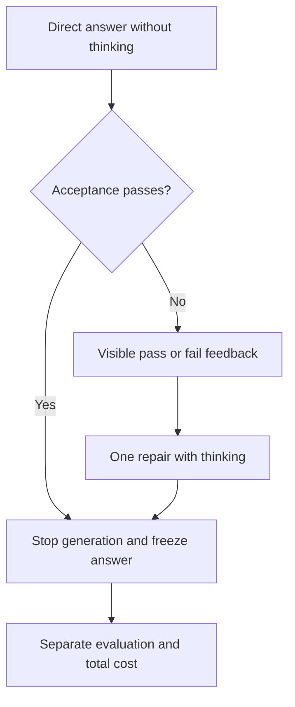

# Direct first, one repair

The first online study found that direct answering was cheaper than periodic
probes on the fixture it solved. This experiment tests a stronger simple control:
spend reasoning tokens only when the cheap answer fails visible checks.



A transport or parsing failure stops the run. Inconclusive verification also
stops, without repair or evaluation. A failed repair terminates. A normal final
candidate is evaluated after generation ends, including a repair that still
fails acceptance. Evaluation never enters feedback and cannot resume generation.

The repair prompt contains the original specification and acceptance examples,
the previous candidate, and only case names with pass/fail status. Candidate
stdout, exceptions, evaluation cases and reference solutions are excluded from
feedback. The verifier still keeps expected answers outside the container.

## Run

Use the pinned image and private vLLM setup from [the GPU runbook](gpu-baseline.md).
From the repository root:

```bash
cargo run --locked -- repair \
  --task tasks/dev/binary-search \
  --endpoint http://127.0.0.1:8000/v1 \
  --model Qwen/Qwen3-8B \
  --output runs/repair-binary-search
```

`--direct-config` defaults to `configs/gpu-nonthinking.json` and
`--repair-config` to `configs/gpu-thinking.json`. Thinking must be explicitly off
for direct and on for repair. Each request has its own 4,096-token ceiling, so a
two-request run can generate up to 8,192 tokens. Verifier settings must match.

Artifacts preserve both configurations, every request and response, each
candidate, visible feedback when used, events, total usage and final scoring.
Missing usage makes the corresponding aggregate null, including transport
failures. Existing output directories are refused. HTTP transport failures can
have no response bytes; their attempted request remains recorded.

## Development screen

[tasks/dev/set.json](../tasks/dev/set.json) freezes ten varied public synthetic
fixtures and their manifest hashes. Each has four acceptance and four evaluation
cases. Schema 2 uses `repo/solution.py` and `solve(array)`. Schema 1 retains
`ranges.py` and `merge_ranges(array)`. Internally the sandbox always mounts the
candidate as `ranges.py`; this internal filename does not change task semantics.

Compare non-thinking, full thinking and direct plus one repair, once per task
with seed 42 and a frozen shuffled order. Thinking and non-thinking use their
respective recommended sampling profiles, so the comparison evaluates complete
policies rather than isolating the thinking flag alone. Disable prefix caching
for all trials, retain metrics before and after each run, and include failures.

`scripts/development-screen.py` consumes a local session directory containing a
frozen `plan.json` and `allocation.json` with a UTC deadline. It requires the
source commit and task manifest hashes to match, refuses reruns and captures
all outcomes. Hardware provisioning and deletion are separate actions.

Trial allocation time includes generation, verification, client process work
and metrics collection while the one GPU is exclusively rented. Engine timing
counters measure request processing, not CUDA kernel time. Full rental duration
also includes setup and gaps between trials. Per-policy trial cost is a sequential
allocation estimate; shared setup has no unique per-policy allocation. Report
these separately. Tokens alone do not establish a compute saving.

These small public tasks are a development screen, not held-out benchmark or
real upstream bugs. One seed and ten tasks cannot establish general quality or
savings. If direct answers already solve everything, that is evidence that the
tasks are too easy to test whether repair helps.
