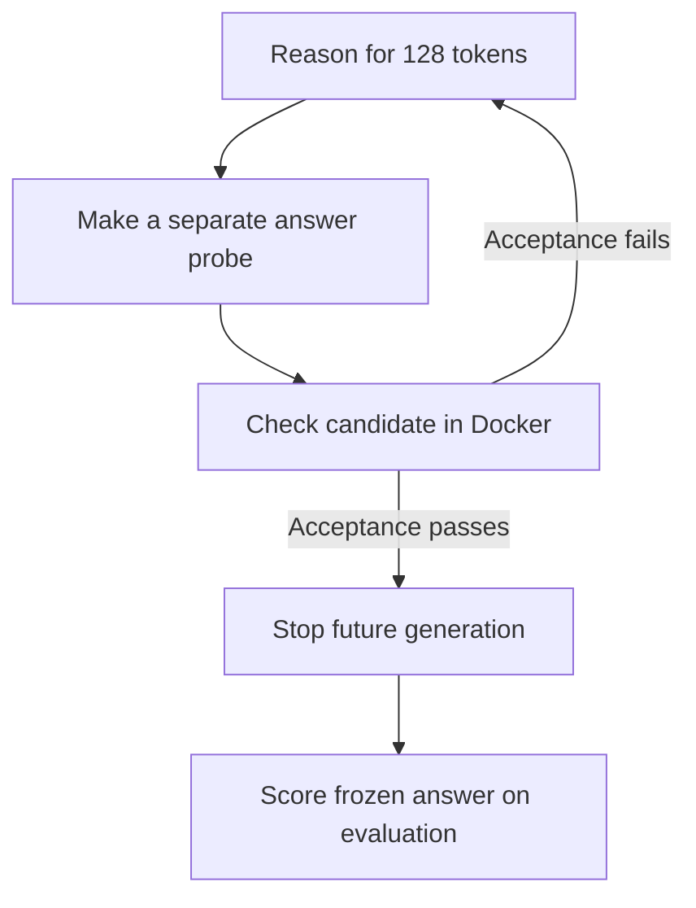

# First online stopping loop

We are testing whether a model already knows a valid fix before it finishes
thinking. The Rust controller asks for an answer at a few checkpoints and lets
executable tests decide whether to stop.



## What is implemented

The `baseline` command now accepts recorded thinking settings through
`configs/gpu-thinking.json` and `configs/gpu-nonthinking.json`. The `online`
command implements both exact-token segmented continuation and bounded periodic
probes. It is experimental and specific to Qwen3-8B with the pinned vLLM 0.10.2
protocol. It requires `/tokenize`, `/detokenize`, and `/v1/completions` returning
both prompt and generated token IDs.

A checkpoint completes a short generation request. The controller carries the
returned integer tokens into the next request, rather than re-tokenizing text.
For an answer probe, it copies the main prefix and adds `</think>` if reasoning
is still open. It never appends that closure, the probe output, or test feedback
to the main branch. If reasoning resumes, it uses the original main tokens.

Draft code inside a closed thinking envelope is excluded before parsing.
Only a naturally stopped probe containing exactly one complete final Python block is
eligible for execution. The Docker verifier uses visible acceptance cases to
make the stopping decision. Evaluation runs after that decision and never
feeds back into generation. A verifier fault aborts as inconclusive. All
transport failures and malformed responses remain recorded failures.

## Four controls

| Policy | Purpose |
| --- | --- |
| Full thinking | Normal uninterrupted model request |
| Non-thinking | Check whether reasoning is needed at all |
| Segmented, no probes | Measure effects of checkpointing and replay |
| Periodic probes | Stop when a separate candidate passes acceptance |

The fixed development settings are 4096 main output tokens, segments of 128,
probe answers capped at 1024, and at most four probes. A failed probe does not
reduce the remaining main budget. The worst-case generation allowance therefore
includes up to 4096 additional probe tokens. Replay prompt tokens, tokenization,
HTTP calls, Docker waits, and failed attempts are all recorded, rather than
counting only the shortened main reasoning trace.

## Run it

First serve the [pinned GPU stack](gpu-baseline.md), then connect through SSH.
From the repository root, with Docker and its pinned image ready:

```sh
cargo run --locked -- baseline --config configs/gpu-thinking.json \
  --model Qwen/Qwen3-8B --output runs/thinking-001
cargo run --locked -- baseline --config configs/gpu-nonthinking.json \
  --model Qwen/Qwen3-8B --output runs/nonthinking-001
cargo run --locked -- online --config configs/gpu-thinking.json \
  --model Qwen/Qwen3-8B --segment-tokens 128 --max-probes 0 \
  --output runs/segmented-001
cargo run --locked -- online --config configs/gpu-thinking.json \
  --model Qwen/Qwen3-8B --segment-tokens 128 --probe-tokens 1024 \
  --max-probes 4 --output runs/probes-001
```

Use `--endpoint` for another tunnel port and `--task tasks/merge-ranges-multi-bug`
for the second fixture. That fixture adds input mutation, missing invalid-range
validation, and incorrect interval boundaries alongside the nested-range bug.
These are two related public fixtures, not independent held-out tasks.

## Evidence and limitations

Every HTTP exchange is saved with a sequence number. Events identify main and
probe prefix hashes, candidate hashes, acceptance decisions, and final outcomes.
`accounting.json` counts requests and every reported generation token, including
replayed prompt and probe output. Missing usage remains unknown. GPU-seconds
remain unknown; client wall time is not silently renamed as a GPU measurement.

This implementation replays prefixes through HTTP. It does not fork KV cache,
resume RNG state, cancel an active GPU request, or choose checkpoints adaptively.
A request finishes at each checkpoint; early exit skips future requests. Seeds
reset per segment, so segmented reasoning is not guaranteed to match a single
uninterrupted trajectory. Compare it with the segmented no-probe control.

The intended live experiment runs all four policies once on each fixture,
with seed 42 and no tuning after evaluation. Model-recommended sampling differs
between thinking and non-thinking. Order and cache state are recorded. Retain
all failures, measure replay/probe overhead, and remove the experiment Pod after
copying logs and artifacts. Successful mechanics on these fixtures do not prove
quality generalization or savings against the strongest baseline.

Protocol source:
[vLLM 0.10.2](https://github.com/vllm-project/vllm/blob/v0.10.2/vllm/entrypoints/openai/protocol.py).
